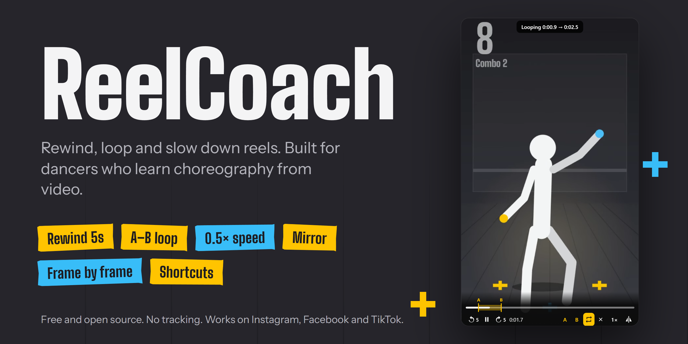
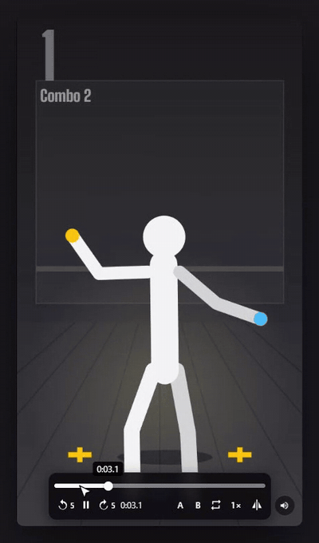
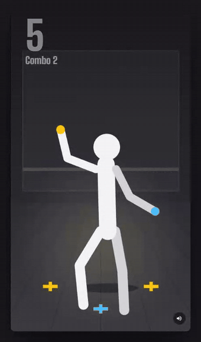
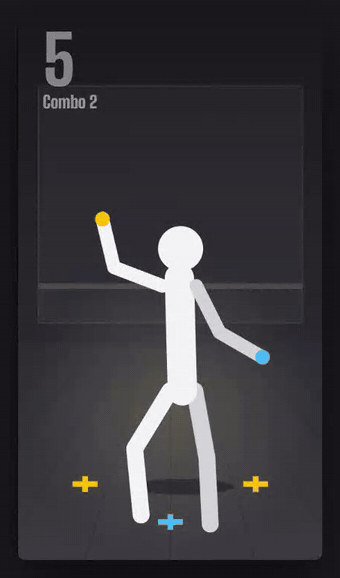
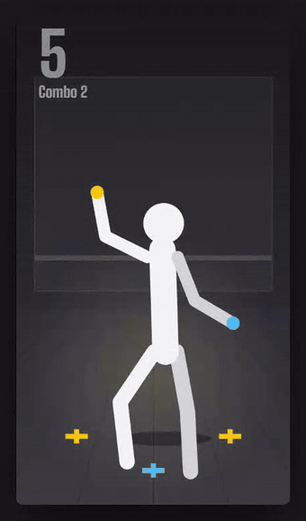
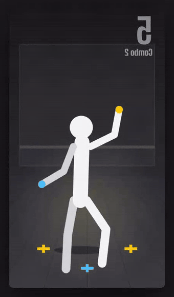
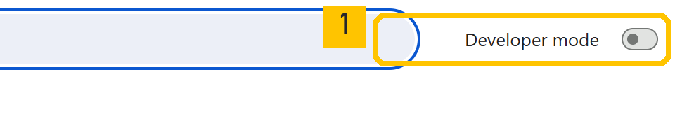
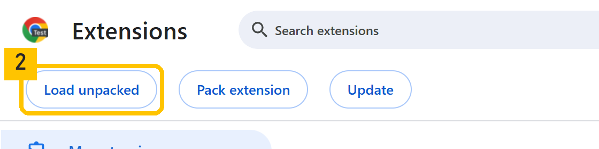
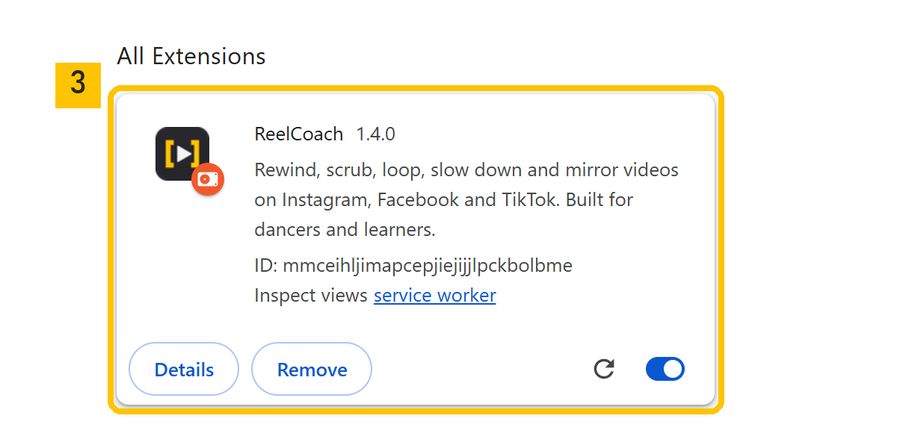
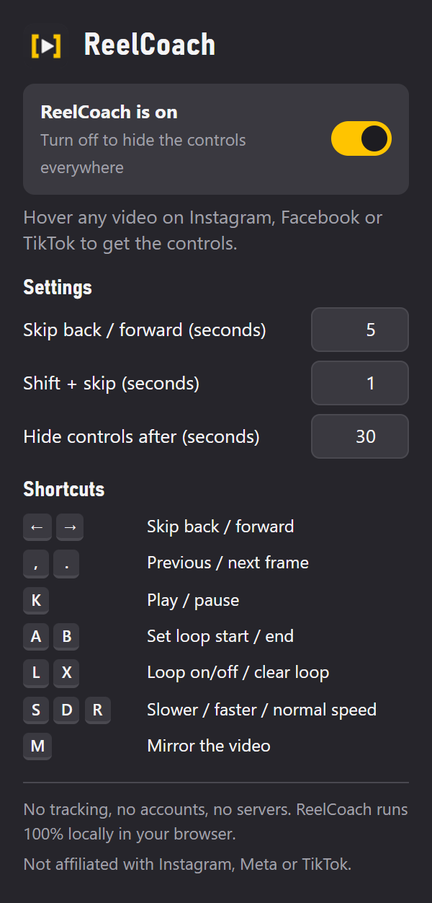

<p align="center">
  
</p>

<p align="center">
  <a href="https://chromewebstore.google.com/detail/reelcoach/igpcmakcnpbfncbignegpkpmgoieogdp"></a>
</p>

<p align="center">
  <a href="https://chromewebstore.google.com/detail/reelcoach/igpcmakcnpbfncbignegpkpmgoieogdp"></a>
  <a href="LICENSE"></a>
  <a href="PRIVACY.md"></a>
  
  
</p>

<p align="center">
  <b>Works on Instagram&nbsp;&nbsp;·&nbsp;&nbsp;Facebook reels &amp; stories&nbsp;&nbsp;·&nbsp;&nbsp;TikTok</b>
</p>

---

You found the routine. Now you need the third eight-count — again, and again, slower, from the mirror side.

Reels and short videos make that hard: no rewind, no timeline to grab, no way to repeat one section. **ReelCoach** puts real practice controls on top of the videos you already watch, so you can learn the choreography instead of fighting the player.

<p align="center">
  
</p>

## What you get

<table>
  <tr>
    <td width="50%" align="center"></td>
    <td width="50%">
      <h3>Loop the part you're learning</h3>
      Press <kbd>A</kbd> where the combo starts and <kbd>B</kbd> where it ends — that section repeats until you've got it. Drag the yellow markers to fine-tune, switch the loop off and on with <kbd>L</kbd>, or clear it with <kbd>X</kbd>.
    </td>
  </tr>
  <tr>
    <td width="50%">
      <h3>A timeline you can actually grab</h3>
      Click or drag anywhere on the timeline, with the exact time shown under your cursor. Missed a move? <kbd>←</kbd> jumps back 5 seconds, <kbd>Shift</kbd>+<kbd>←</kbd> jumps back 1.
    </td>
    <td width="50%" align="center"></td>
  </tr>
  <tr>
    <td width="50%" align="center"></td>
    <td width="50%">
      <h3>Slow it down. Flip it.</h3>
      Practice anywhere from 0.25× to 2× with the music's pitch kept natural. Mirror the video so the dancer moves the same way you see yourself in the studio mirror — it stays mirrored until you turn it off.
    </td>
  </tr>
  <tr>
    <td width="50%">
      <h3>Frame by frame</h3>
      Pause with <kbd>K</kbd>, then step through the move one frame at a time with <kbd>.</kbd> and <kbd>,</kbd> to see exactly where the weight shifts.
    </td>
    <td width="50%" align="center"></td>
  </tr>
</table>

The controls appear when you hover a video and fade away when you stop moving the mouse, so they never get in the way while you dance.

## Install

### Chrome Web Store (recommended)

<a href="https://chromewebstore.google.com/detail/reelcoach/igpcmakcnpbfncbignegpkpmgoieogdp"></a>

1. Open the [ReelCoach page on the Chrome Web Store](https://chromewebstore.google.com/detail/reelcoach/igpcmakcnpbfncbignegpkpmgoieogdp) and click **Add to Chrome**.
2. Pin it: click the puzzle-piece icon in Chrome's toolbar, then the pin next to ReelCoach.
3. Open Instagram, Facebook or TikTok and hover a video.

Works in Chrome 111 or newer and in Chromium browsers that install from the Chrome Web Store (Edge, Brave, Arc, Opera).

### From source (for developers)

<details>
<summary>Load the extension from this repository</summary>

1. Clone the repository, or download it with **Code → Download ZIP** and unzip it.
2. Go to `chrome://extensions` and turn on **Developer mode** (top-right).

   

3. Click **Load unpacked** and choose the folder that contains `manifest.json`.

   

4. ReelCoach appears in your extensions list, switched on.

   

5. Refresh any open Instagram, Facebook or TikTok tabs.

There's no build step and no dependencies: edit a file, click the reload icon on the ReelCoach card, refresh the tab.

</details>

## Keyboard shortcuts

| Key | What it does |
|---|---|
| <kbd>←</kbd> / <kbd>→</kbd> | Skip back / forward 5 s (while the mouse is over the video) |
| <kbd>Shift</kbd> + <kbd>←</kbd> / <kbd>→</kbd> | Skip back / forward 1 s |
| <kbd>,</kbd> / <kbd>.</kbd> | Previous / next frame |
| <kbd>K</kbd> | Play / pause |
| <kbd>A</kbd> / <kbd>B</kbd> | Set loop start / loop end at the current moment |
| <kbd>L</kbd> | Turn the loop on or off |
| <kbd>X</kbd> | Clear the loop |
| <kbd>S</kbd> / <kbd>D</kbd> / <kbd>R</kbd> | Slower / faster / back to normal speed |
| <kbd>M</kbd> | Mirror the video |

Shortcuts never fire while you're typing a comment or searching, and arrow keys only skip while your mouse is over a video — so each site's own navigation keeps working.

## Settings



Click the ReelCoach icon in Chrome's toolbar to:

- **switch ReelCoach on or off** — while it's off, the icon shows **OFF** and every video is left alone;
- choose how far the skip buttons jump;
- choose how quickly the controls fade.

Your settings sync across your Chrome browsers if you use Chrome Sync.

<br clear="right">

## Where it works

| Site | Where the controls appear |
|---|---|
| **Instagram** | Reels, posts and the scrolling Reels feed |
| **Facebook** | Reels and stories. Regular Facebook videos already have a timeline, so ReelCoach stays out of their way. |
| **TikTok** | Videos in the For You feed |

## Privacy

ReelCoach has **no servers, no analytics, no accounts and no ads**. It makes **zero network requests** and never collects, stores or sends anything about you. The only thing it saves is your handful of settings. Full details: [PRIVACY.md](PRIVACY.md).

| Access | Why | What it never does |
|---|---|---|
| Runs on `instagram.com`, `facebook.com` and `tiktok.com` | To draw the controls over videos | Runs on any other site, or reads your cookies, logins or history |
| `storage` permission | To remember your settings | Stores anything personal |

## Security

ReelCoach went through a structured source audit ([cloudflare/security-audit-skill](https://github.com/cloudflare/security-audit-skill)) and was hardened afterwards:

- Only real clicks and key presses operate the controls — scripts on a page can't press its buttons (`event.isTrusted`).
- The controls live in their own Shadow DOM layer, separate from the site's page.
- No `eval`, no remote code, no third-party libraries, one permission.

Found a problem? Please report it privately — see [SECURITY.md](SECURITY.md).

## FAQ

**The controls don't appear.** Refresh the tab after installing or updating, and check that ReelCoach is switched on in its menu. The controls also step aside while a pop-up (like a sign-in box) covers the video.

**Why no controls on a regular Facebook video?** Facebook's own player already has a timeline there, and ReelCoach's bar would cover its mute button. It appears on Facebook reels and stories.

**A Facebook story pauses when my mouse is on it.** That's Facebook's own behaviour — it pauses stories while you hover. ReelCoach keeps the story playing while you use its controls; click the video or press <kbd>K</kbd> when you want it paused.

**A skip back pauses for a moment.** That part of the video hadn't loaded yet; ReelCoach waits for it and carries on.

**Can it download videos?** No. ReelCoach is a practice tool: it doesn't download, store or upload anything.

## Contributing

Bug reports and pull requests are welcome — see [CONTRIBUTING.md](CONTRIBUTING.md). Sites change their players often; if something stops working, an issue with your browser version, the site and what you saw is the most helpful thing you can send.

```
manifest.json        Extension manifest (Manifest V3)
src/content.js       Controls, looping, timeline, speed, mirror and shortcuts
src/background.js    Toolbar badge (on/off)
popup.html, popup.js Settings menu
icons/               Extension icons
docs/images/         README images, made with an original animated clip
```

## License

[MIT](LICENSE) © ReelCoach contributors.

<sub>ReelCoach is an independent open-source project, not affiliated with, endorsed by or sponsored by Instagram, Facebook, Meta or TikTok. Instagram and Facebook are trademarks of Meta Platforms, Inc.; TikTok is a trademark of ByteDance Ltd.</sub>
